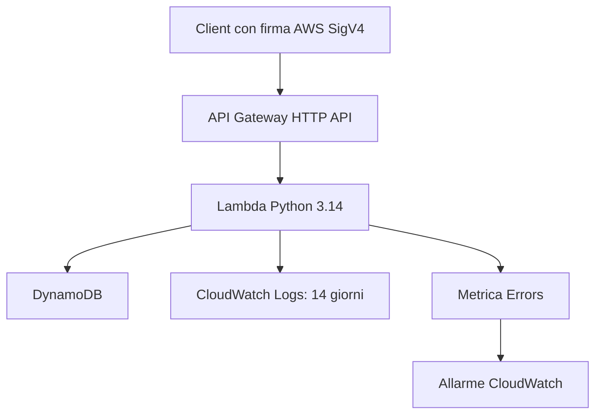

# Notes API Serverless

API Python per creare, leggere ed eliminare note, distribuita su AWS
con Terraform e GitHub Actions.

Il progetto dimostra sviluppo e test Python, infrastruttura come codice,
autenticazione IAM, deploy automatico tramite OIDC e monitoraggio.

## Architettura



GitHub Actions esegue i controlli sulle pull request e distribuisce
gli aggiornamenti dopo un push o merge su main.

Lo stato Terraform è conservato in un bucket S3 privato con versioning,
cifratura e locking nativo.

## Endpoint

Tutte le operazioni richiedono autenticazione IAM con firma SigV4
e permesso execute-api:Invoke.

| Metodo | Percorso | Risposta di successo |
|---|---|---|
| POST | /notes | 201: nota creata |
| GET | /notes/{id} | 200: nota trovata |
| GET | /notes | 200: elenco delle note |
| DELETE | /notes/{id} | 204: nota eliminata |

Esempio di corpo della richiesta POST:

```json
{
  "title": "Studiare AWS",
  "content": "Ripassare Lambda e DynamoDB"
}
```

La nota include id UUID e data di creazione UTC generati automaticamente.

Regole:
- Titolo obbligatorio, massimo 200 caratteri dopo la rimozione degli spazi esterni.
- Contenuto facoltativo, massimo 10.000 caratteri.
- Dati non validi: 400.
- Nota inesistente: 404.

Aprire l'URL nel browser non autentica la richiesta: un 403 su /notes
senza firma è il comportamento previsto.

## Organizzazione del codice

| File o cartella | Responsabilità |
|---|---|
| notes/domain.py | Modello della nota e validazione |
| notes/service.py | Operazioni applicative e contratto del repository |
| notes/http.py | Gestione delle richieste e risposte HTTP |
| notes/dynamodb_repository.py | Persistenza DynamoDB |
| notes/lambda_handler.py | Adattatore per gli eventi API Gateway |
| tests/ | 74 test automatici locali |
| infra/ | Infrastruttura Terraform |
| scripts/build_lambda.py | Pacchetto ZIP con codice e dipendenze |
| scripts/smoke_test.py | Verifica delle operazioni sull'API distribuita |
| .github/workflows/ci-cd.yml | Pipeline CI/CD |

La logica delle note è separata da Lambda e DynamoDB per poter essere
riutilizzata con altri adattatori, per esempio FastAPI.

## Ambiente locale

Prerequisiti: Python 3.14 con supporto venv, Git, AWS CLI v2 e
Terraform 1.17.1.

Dalla cartella del repository:

```bash
python3 -m venv .venv
source .venv/bin/activate
python -m pip install -r requirements-dev.txt
python -m pytest -q
```

Risultato verificato: 74 test superati.

I test locali usano un repository in memoria o risposte DynamoDB simulate.
Non richiedono risorse AWS.

## Configurazione AWS

Regione del laboratorio: us-east-1.

La configurazione presente è riferita all'account AWS e al repository
GitHub dell'autore. Per riutilizzarla in un altro account occorre adattare
account ID, nomi, ARN, backend e soggetto OIDC.

Preparazione iniziale:
1. Configurare un'identità AWS con i permessi necessari.
2. Preparare il bucket S3 del backend con versioning, cifratura e blocco
   dell'accesso pubblico.
3. Configurare il provider OIDC GitHub nell'account AWS.
4. Verificare il soggetto OIDC effettivo del repository.

Il bucket del backend e il provider OIDC preesistenti non sono creati
da questa configurazione Terraform.

Il ruolo GitHub accetta soltanto il soggetto del branch main di questo
repository, inclusi gli ID immutabili del proprietario e del repository.

## Deploy dal terminale

Autenticarsi con il profilo locale del laboratorio:

```bash
export AWS_PROFILE=portfolio
aws login --profile portfolio
```

Preparare il pacchetto e controllare l'infrastruttura:

```bash
python scripts/build_lambda.py
terraform -chdir=infra init
terraform -chdir=infra fmt -check -recursive
terraform -chdir=infra validate
terraform -chdir=infra plan -out=deploy.tfplan
```

Dopo aver esaminato il piano, applicarlo:

```bash
terraform -chdir=infra apply deploy.tfplan
```

Lo ZIP deve essere ricreato quando cambiano codice o dipendenze.
Il file infra/.terraform.lock.hcl è conservato nel repository.
Stato, piani, ambiente virtuale e pacchetti generati sono esclusi da Git.

## Pipeline CI/CD

| Evento | Comportamento |
|---|---|
| Pull request verso main | Test, build, fmt e validate senza accesso AWS |
| Push su main | Controlli, autenticazione OIDC, plan, apply e smoke test |
| Avvio manuale su main | Stesso percorso di controlli e deploy |

Il deploy:
- Usa credenziali AWS temporanee, senza access key salvate su GitHub.
- Usa lo stesso backend S3 del terminale locale.
- Esegue un deploy alla volta tramite il gruppo di concorrenza.
- Applica il piano generato nella stessa esecuzione.
- Verifica l'API dopo il deploy.

I controlli sulle PR sono configurati nel workflow; il blocco del merge
richiede separatamente regole di protezione del branch.

Le modifiche alla fiducia e ai permessi del ruolo GitHub stesso
richiedono l'identità di amministrazione del laboratorio.

## Verifica dell'API distribuita

Con credenziali autorizzate a invocare l'API:

```bash
python scripts/smoke_test.py
```

Lo script legge l'URL dagli output Terraform e verifica:
1. Creazione: 201.
2. Lettura: 200.
3. Presenza nell'elenco: 200.
4. Rifiuto del titolo vuoto: 400.
5. Eliminazione: 204.
6. Lettura della nota eliminata: 404.

La nota di prova viene eliminata. Lo script non stampa le credenziali.

## Monitoraggio verificato

- Gruppo log: /aws/lambda/notes-api-serverless.
- Retention: 14 giorni.
- Allarme: notes-api-lambda-errors.
- Condizione: almeno un errore Lambda in cinque minuti.
- Dati mancanti trattati come non in violazione.

L'allarme è stato verificato invocando direttamente Lambda con un evento
vuoto: l'handler ha generato il KeyError atteso e CloudWatch è passato
da OK ad ALARM dopo aver rilevato un errore.

Questo test verifica gli errori di esecuzione Lambda.
Una risposta applicativa 400 gestita correttamente non incrementa
automaticamente la metrica Errors.

Non sono configurate notifiche email.

## Scelte architetturali e limiti

| Scelta | Motivazione o limite |
|---|---|
| Lambda | Esecuzione su richiesta senza amministrare un server |
| DynamoDB on-demand | Capacità gestita in base alle richieste |
| HTTP API | Ingresso HTTPS e integrazione con Lambda |
| Autenticazione IAM | Accesso riservato a identità AWS autorizzate |
| Repository separato dalla logica | Riutilizzo del codice e test senza AWS |
| Locking S3 nativo | Coordinamento dello stato senza tabella di locking aggiuntiva |
| Scan paginata | Una richiesta DynamoDB per pagina, con limite e cursore |
| Nessuna separazione per utente | Le identità autorizzate accedono allo stesso insieme di note |

L'elenco restituisce una pagina alla volta: 20 note per impostazione
predefinita, massimo 100. L'eventuale next_cursor permette di continuare.
La scansione non garantisce ordine cronologico né una fotografia
immutabile della tabella durante modifiche concorrenti.

Non sono configurati backup applicativi o point-in-time recovery
della tabella. Il versioning S3 protegge le versioni dello stato Terraform,
non i dati delle note.

## Costi

Il progetto può generare costi AWS:
- Richieste HTTP API.
- Richieste e durata delle esecuzioni Lambda.
- Letture, scritture e spazio DynamoDB.
- Ingestione e conservazione dei log CloudWatch.
- Allarme CloudWatch.
- Richieste e spazio S3, incluse le versioni precedenti dello stato.

Crediti e franchigie dipendono dall'account.
Il budget AWS è un avviso e non un blocco automatico della spesa.

## Eliminazione delle risorse

Prima della pulizia, disabilitare il workflow nella scheda Actions
per evitare che un successivo push avvii nuovamente il deploy.

Dal terminale locale, con il profilo autorizzato e il pacchetto ZIP presente:

```bash
export AWS_PROFILE=portfolio
terraform -chdir=infra plan -destroy -out=cleanup.tfplan
```

Esaminare attentamente il piano. Per eseguire la distruzione:

```bash
terraform -chdir=infra apply cleanup.tfplan
```

La distruzione elimina anche la tabella e tutte le note.
Il ruolo GitHub non dispone di tutti i permessi per questa pulizia:
usare l'identità locale autorizzata del laboratorio.

Il bucket del backend e il provider OIDC restano perché sono esterni
a questa configurazione. Conservare il backend fino al completamento
della distruzione e alla verifica del risultato.

Le risorse del portfolio del progetto 1 appartengono a una configurazione
separata e non sono incluse nello stato di questo progetto.

## Paginazione HTTP

Richieste supportate:

```text
GET /notes
GET /notes?limit=5
GET /notes?limit=5&cursor=VALORE_RICEVUTO
```

La risposta contiene notes e, se la scansione può continuare, next_cursor.
Per proseguire, passare next_cursor come parametro cursor.
L'assenza di next_cursor indica la fine della scansione.

Il limite ammesso è da 1 a 100. Parametri invalidi producono 400.
Il cursore va riutilizzato come ricevuto: non è un numero di pagina.
Una pagina successiva può essere vuota se DynamoDB aveva restituito
una chiave di continuazione al confine della scansione.

Lo smoke test verifica più pagine, assenza di duplicati sui dati stabili
del laboratorio, limiti invalidi e pulizia delle note create.

## Esempi curl autenticati

Prerequisiti: curl con supporto --aws-sigv4, sessione AWS CLI attiva
e permesso execute-api:Invoke sull'API.

Il seguente blocco usa una subshell: le credenziali temporanee esportate
rimangono disponibili soltanto al suo interno.

```bash
(
  export AWS_PROFILE=portfolio
  API_URL=$(terraform -chdir=infra output -raw api_url)
  eval "$(aws configure export-credentials --format env)"

  curl --fail-with-body \
    --aws-sigv4 "aws:amz:us-east-1:execute-api" \
    --user "$AWS_ACCESS_KEY_ID:$AWS_SECRET_ACCESS_KEY" \
    --header "X-Amz-Security-Token: $AWS_SESSION_TOKEN" \
    --header "Content-Type: application/json" \
    --data '{"title":"Nota da curl","content":"Prova autenticata"}' \
    "$API_URL/notes"

  curl --fail-with-body \
    --aws-sigv4 "aws:amz:us-east-1:execute-api" \
    --user "$AWS_ACCESS_KEY_ID:$AWS_SECRET_ACCESS_KEY" \
    --header "X-Amz-Security-Token: $AWS_SESSION_TOKEN" \
    "$API_URL/notes?limit=5"
)
```

La nota creata da questo esempio rimane nella tabella.
Per una prova con pulizia automatica usare scripts/smoke_test.py.
Non pubblicare credenziali, token o header Authorization nei log.

## Variabili Terraform

| Variabile | Default | Uso |
|---|---|---|
| project_name | notes-api | Prefisso dei nomi delle risorse |
| environment | lab | Tag Environment; valori lab, dev, prod |

I valori predefiniti mantengono i nomi delle risorse esistenti.
Cambiare project_name può richiedere sostituzioni e adeguamenti IAM.
Cambiare soltanto environment non crea un ambiente indipendente.

Il backend è configurato separatamente: Terraform non accetta queste
variabili nel blocco backend. Ambienti indipendenti richiedono stati
separati e nomi di risorse non in conflitto.

## Scelte da spiegare al colloquio

- HTTP API: adatta a queste route e all'integrazione Lambda.
  REST API offre ulteriori funzionalità, per esempio usage plan con
  API key e validazione delle richieste gestita da API Gateway.
- Ruolo Lambda: consente PutItem, GetItem, Scan e DeleteItem soltanto
  sulla tabella delle note, più la scrittura nel proprio gruppo log.
  È distinto dal ruolo usato da GitHub per distribuire l'infrastruttura.
- Terraform state: associa le risorse dichiarate a quelle reali.
  S3 lo rende condiviso; il locking coordina le operazioni che lo modificano.
- Cold start: preparazione di un nuovo ambiente di esecuzione Lambda.
  Può aumentare la latenza di una richiesta; conta soprattutto quando
  il servizio ha requisiti di latenza stretti.
- Retention: limita il tempo di conservazione dei log e l'accumulo
  di spazio. Non elimina i costi di ingestione dei log.

## Cosa farei dopo

- Cognito per autenticare gli utenti dell'applicazione.
- Separazione dei dati per utente, oltre alla sola autenticazione.
- Versioni Lambda pubblicate e alias per distinguere i rilasci.
- Canary deployment per distribuire gradualmente nuove versioni,
  con monitoraggio e rollback.
- Modello DynamoDB basato sui reali accessi, usando Query dove opportuno.
- Backup e prova di ripristino dei dati delle note.
- Notifiche dell'allarme e protezione del branch main.

## Riproducibilità e pulizia: stato delle verifiche

Il deploy richiede una preparazione iniziale documentata:
identità e permessi, bucket del backend e provider OIDC.

Prova di distruzione e ricreazione completata il 5 novembre 2026:
- Eliminate tutte le 16 risorse applicative; stato Terraform vuoto.
- Ricreate le 16 risorse dal codice, mantenendo backend e provider OIDC.
- Nuova API verificata con lo smoke test, inclusa la paginazione.
- Terraform plan senza differenze dopo la ricreazione.
- Pipeline OIDC riattivata e completata con successo.

Il tempo della creazione effettiva non è stato misurato correttamente:
non viene quindi dichiarato un deploy inferiore a due minuti.
Le note precedenti sono state eliminate: questa è una prova di
ricreazione dell'infrastruttura, non di ripristino dei dati.

terraform destroy riguarda le risorse nello stato corrente.
Non elimina automaticamente il backend S3, il provider OIDC preesistente
o le policy assegnate all'utente del laboratorio.
